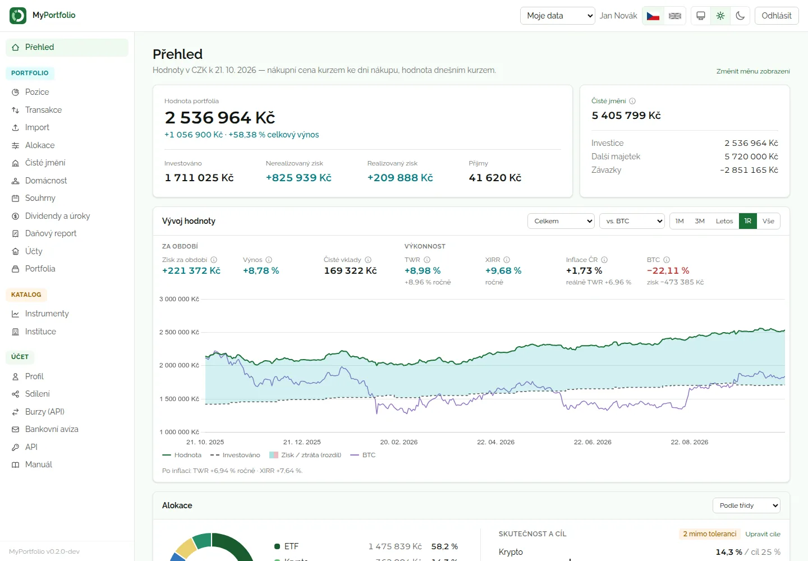
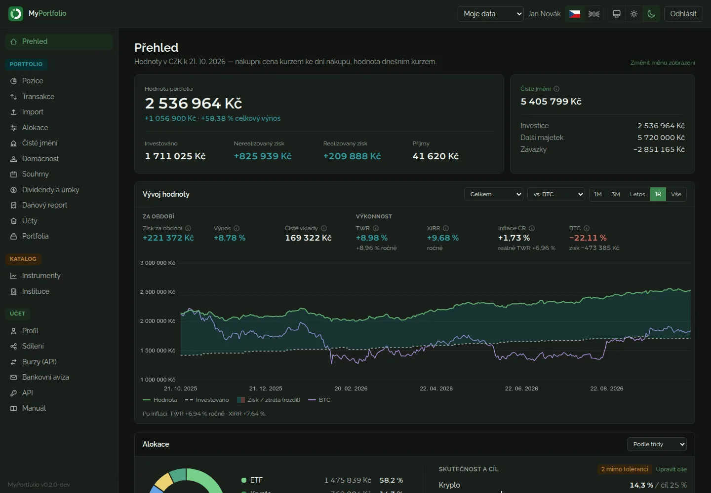
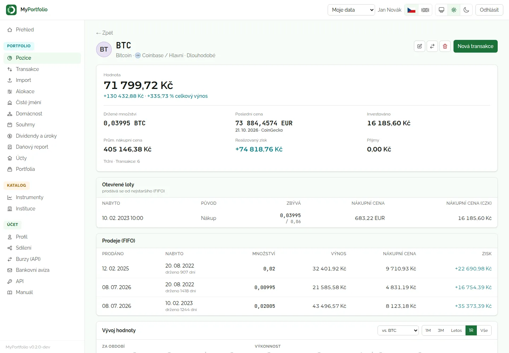
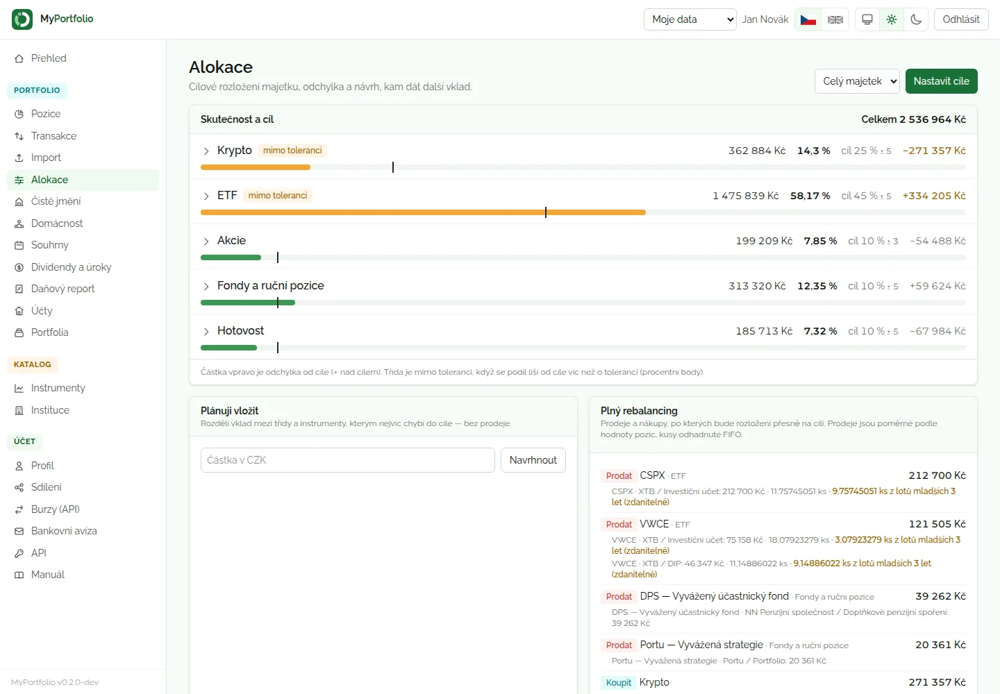
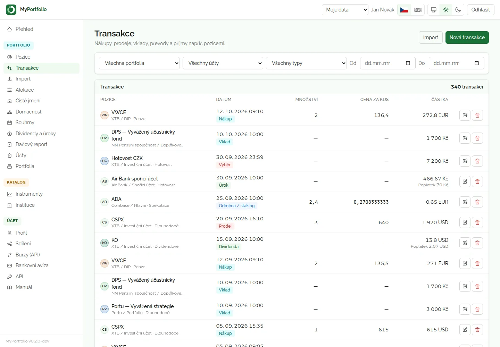
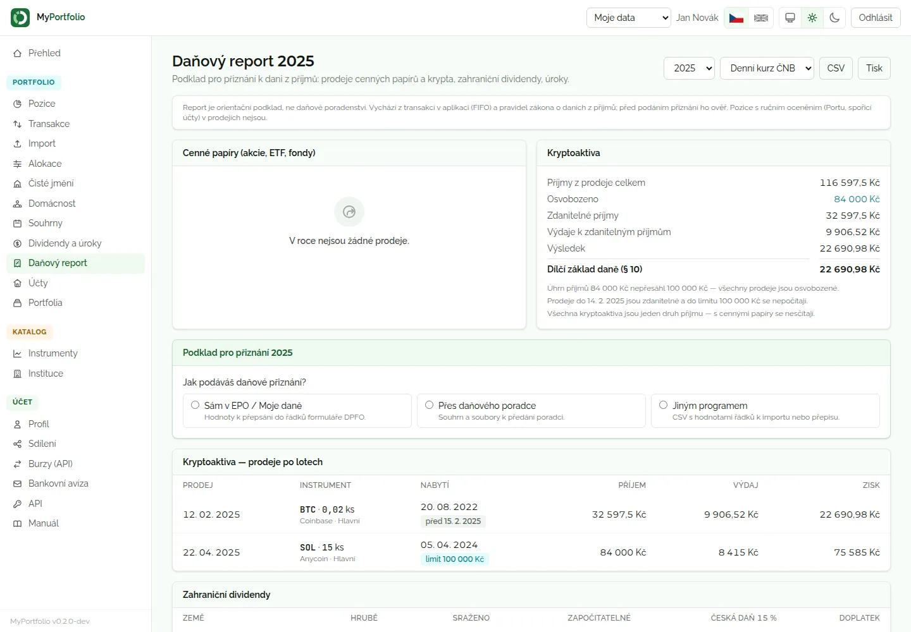
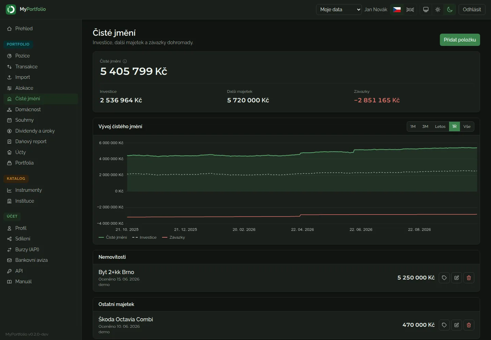
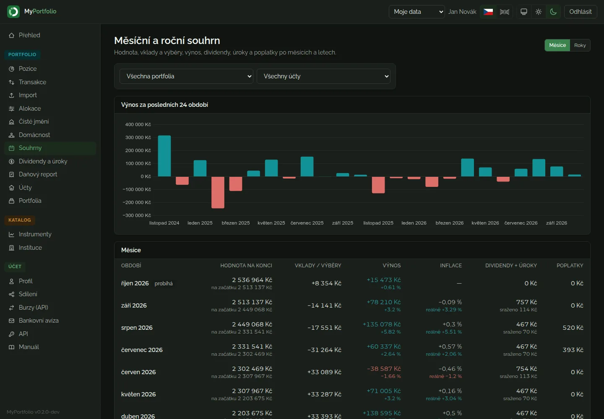
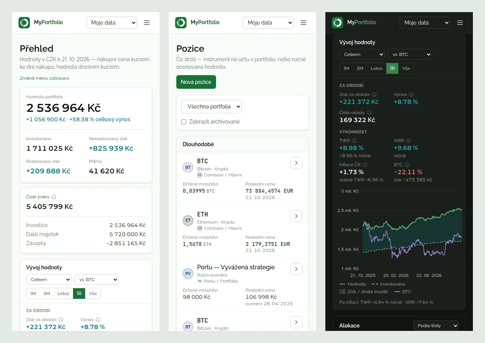

<p align="center">
  
</p>

<h1 align="center">MyPortfolio</h1>

<p align="center">
  Self-hosted přehled osobních investic na jednom místě —<br>
  <strong>krypto, ETF a akcie, robo-advisor Portu, hotovost, penzijko i čisté jmění</strong>.
</p>

<p align="center">
  <a href="LICENSE">MIT</a> ·
  <a href="manual/INDEX.md">Manuál</a> ·
  <a href="CHANGELOG.md">Changelog</a> ·
  verze <code>0.3.1-dev</code>
</p>



MyPortfolio běží na vlastním serveru nebo v Dockeru a data zůstávají u tebe. Jedna instalace slouží
**více uživatelům** — každý vidí jen svá data, sdílený je jen katalog institucí, instrumentů a ceny s kurzy.
Částky, ceny i množství se počítají **přesně v desítkové soustavě** (žádné floaty), kurzy bere z ČNB a
chybějící cenu nikdy tiše nenahradí — ukáže poslední známou se štítkem „zastaralá".

*[English summary below](#in-english).*

> **Stav:** vývojová verze 0.3.1-dev. Všechny funkce níže jsou hotové a pokryté testy; importy z burz a brokerů
> jsou ověřené na syntetických exportech, ne na skutečných souborech.

## Funkce

### Přehled a výkonnost
- **Přehled** v měně zobrazení (CZK / EUR / USD) — hodnota portfolia s celkovým výnosem, investováno,
  realizovaný a nerealizovaný zisk, příjmy, čisté jmění a krypto sečtené napříč účty.
- **Vývoj hodnoty** v čase (1M až Vše) pro celek, portfolio, třídu aktiv i jednu pozici: plocha zisku a ztráty
  proti investovaným penězům, **TWR**, **XIRR**, výnos za období, inflace ČR a reálný výnos.
- **Benchmark** — „kdyby stejné vklady ve stejné dny šly do BTC / indexu / libovolného instrumentu".
- **Alokace** podle třídy aktiv, portfolia nebo instituce a **cílová alokace** s tolerancí, návrhem rozdělení
  vkladu a plným rebalancingem včetně odhadu zdanitelných kusů.
- **Měsíční a roční souhrny** a **dividendy a úroky** po pozicích, letech a platbách.

### Transakce a pozice
- Tržní pozice (krypto, ETF, akcie) i **ručně oceňované** (Portu, spořicí účet, penzijko, DIP).
- Nákup, prodej, odměna / staking, split, vklad, výběr, dividenda, úrok, poplatek a **převody mezi účty**,
  které zachovávají datum nabytí.
- **FIFO loty** s realizovaným a nerealizovaným ziskem; aplikace nedovolí prodat víc, než pozice v danou chvíli držela.
- **Hotovost na účtu** se zadávaným zůstatkem — rozdíl se zapíše jako vklad nebo výběr.

### Importy a napojení
- **Import exportů** (CSV / XLSX / ZIP) — Coinbase, Anycoin, Coinmate, Binance, Kraken, XTB, Trading 212, Revolut,
  DEGIRO, Interactive Brokers. Náhled s párováním instrumentů a převodů, idempotence, vrácení celé dávky.
- **Napojení burz přes API** — Coinbase, Binance, Kraken, Coinmate: read-only klíč uložený šifrovaně, hodinová
  synchronizace, navázání na poslední import.
- **Bankovní e-mailová avíza přes IMAP** — Fio, Air Bank, MONETA, Raiffeisenbank, ČSOB, Česká spořitelna,
  CREDITAS, UniCredit: vklady, výběry, úroky a zůstatek spořicího účtu bez ručního přepisování.
- **Ceny a kurzy** — kurzy ČNB, CoinGecko a Yahoo Finance pro krypto, XTB → Yahoo pro ETF, ruční ceny.

### Daně
- **Daňový report** za rok podle českých pravidel: prodeje cenných papírů a kryptoaktiv po FIFO lotech, limit
  100 000 Kč, časový test 3 roky, zahraniční dividendy po zemích se zápočtem daně, úroky; CSV a tisk.
- **Podklad pro přiznání** podle toho, jak ho podáváš — řádky DPFO k přepsání do EPO, souhrn pro daňového
  poradce, nebo CSV pro jiný program.

### Majetek a domácnost
- **Čisté jmění** — investice + nemovitosti a ostatní majetek − závazky; úvěr jako anuita s mimořádnými splátkami,
  refixací a odhadem doplacení.
- **Sdílení pro domácnost** — celý účet nebo vybraná portfolia, jen pro čtení nebo i pro zápis, pozvánka e-mailem,
  log změn partnera a společná stránka **Domácnost**.

### Upozornění a e-maily
- Týdenní report, měsíční a roční souhrn a denní souhrn upozornění (cenové hranice, velký pohyb, blížící se
  časový test, alokace mimo toleranci, problémy s daty).

### API
- Tokeny s rozsahem `read` / `read_write` pro skripty a integrace; katalog endpointů s ukázkami, tlačítkem
  Vyzkoušet a exportem **OpenAPI 3.1** (`/api/openapi.json`).

## Ukázky

| | |
|---|---|
|  |  |
| **Přehled v tmavém motivu** | **Detail pozice** — souhrn, otevřené loty a prodeje FIFO |
|  |  |
| **Alokace** — skutečnost vs. cíl, návrh vkladu a rebalancing | **Transakce** napříč pozicemi s filtry |
|  |  |
| **Daňový report** s podkladem pro přiznání | **Čisté jmění** — majetek a závazky v čase |
|  |  |
| **Měsíční a roční souhrn** | **Mobil** — karty místo tabulek, graf s dotykovým popiskem |

Screenshoty jsou z ukázkových dat (`api/bin/seed-demo.php`), žádná skutečná čísla.

## Bezpečnost

- Hesla bcrypt s pepperem, ochrana proti hádání hesel (Redis nebo MariaDB), volitelně Cloudflare Turnstile.
- Dvoufázové ověření: **passkeys (WebAuthn)**, TOTP, e-mailový kód, záložní kódy; step-up pro citlivé operace.
- Session cookie `__Host-`, CSRF token, zámek session při nečinnosti, IP allowlist.
- Přísná izolace uživatelů — cizí záznam je 404, ne 403; sdílení jen přes výslovné oprávnění.
- API klíče burz a IMAP hesla šifrovaně, ověření DKIM / Authentication-Results u bankovních avíz.

Zranitelnosti hlas podle [SECURITY.md](SECURITY.md).

## Instalace

Průvodce se zeptá, jestli instalovat přes **Docker**, nebo **nativně** (PHP 8.5 + MariaDB + webserver),
připraví konfiguraci, databázi, build a cron:

```bash
cmd/install.sh                 # nebo: cmd/install.sh --docker | --native [--yes]
```

Pak otevři `<adresa>/setup` — webový průvodce založí správce, nastaví jazyk a měnu, MFA, SMTP a volitelně
nahraje ukázková data. Podrobně v [manuálu, kapitola 2](manual/02_Instalace.md).

Hotový Docker image je v GHCR (`ghcr.io/jindrichmach/myportfolio:0.3.1-dev`), produkční compose v
[`docker-compose.production.yml`](docker-compose.production.yml). Vývojové verze (`-dev`) nedostávají značku
`latest` — v compose uveď konkrétní verzi.

### Plánované úlohy

| Úloha | Kdy | Co dělá |
|---|---|---|
| `cron-fx` | pracovní dny 14:45 | kurzovní lístek ČNB |
| `cron-prices` | každou hodinu | ceny instrumentů |
| `cron-snapshot` | denně 0:30 | denní snapshoty hodnoty pro grafy a metriky |
| `cron-exchange-sync` | každou hodinu | synchronizace napojených burz |
| `cron-bank-notices` | každých 15 min | bankovní avíza z IMAP |
| `cron-cpi` | denně 6:40 | index cen HICP (inflace ČR) |
| `cron-alerts` | denně 7:30 | souhrn upozornění e-mailem |
| `cron-weekly-report` | pondělí 8:00 | týdenní report |
| `cron-period-report` | 1. den v měsíci 8:05 | měsíční a v lednu roční souhrn |
| `cron-backup`, `cron-cleanup` | denně 2:00 a 3:00 | záloha databáze a úklid |

Hotový crontab je v [`cmd/crontab`](cmd/crontab), v Dockeru se generuje sám. Přehled posledních běhů je v aplikaci
v **Systém → Plánované úlohy**.

## Lokální vývoj

```bash
cp cfg.sample.php cfg.php                        # vyplň db.*, app.pepper, app.url
cd api && composer install && cd ..
php8.5 api/bin/migrate.php                       # migrace vždy jen tímto skriptem
cd web && pnpm install && pnpm build && cd ..
php8.5 -S 127.0.0.1:8080 api/bin/dev-server-router.php
# http://127.0.0.1:8080/setup — založí správce (nebo php8.5 api/bin/setup.php)
php8.5 api/bin/seed-demo.php --user=<email>      # ukázková data (volitelně --backfill)
```

Pro adresu `http://` (bez TLS) nastav v `cfg.php` cookies bez příznaku Secure — postup je u klíčů `session`
v `cfg.sample.php`; `cmd/install.sh` to udělá sám.

Alternativně Apache vhost s docrootem v rootu repa — pravidla jsou v `.htaccess` (a jejich kopie v `docker/nginx.conf`).

Testy:

```bash
# jednorázově: testovací DB myportfolio_test (název nastavuje api/phpunit.xml)
MYPORTFOLIO_DB_NAME=myportfolio_test php8.5 api/bin/migrate.php
MYPORTFOLIO_DB_NAME=myportfolio_test php8.5 api/bin/ci-seed.php

cd api && php8.5 vendor/bin/phpunit              # PHPUnit; HTTP testy potřebují běžící server (MYPORTFOLIO_TEST_URL)
cd web && pnpm build && pnpm test:pwa            # typová kontrola, build a testy frontendu
```

## Stack

| Vrstva | Technologie |
|---|---|
| Backend | PHP 8.5, Slim 4, PHP-DI 7, Twig 3, Monolog 3, brick/math |
| Databáze | MariaDB 11.x, Redis 7 volitelně |
| Frontend | Vue 3.5, TypeScript, Vite 8, Tailwind CSS 4, Pinia, vue-i18n (čeština a angličtina), Chart.js |
| Testy | PHPUnit 13, vue-tsc, node:test |
| Nasazení | Docker (nginx + php-fpm, Alpine), GitHub Actions → GHCR |

Rozhraní má světlý i tmavý motiv a mobilní zobrazení; písmo Raleway, JetBrains Mono a číslice z Montserrat
(tabulkové, aby částky ve sloupcích seděly pod sebou), vše přibalené bez externích CDN.

## Struktura repa

```
api/             PHP backend (src/, bin/ — CLI a cron, tests/, templates/)
web/             Vue 3 SPA (src/, public/, tests/)
db/migrations/   číslované idempotentní SQL migrace
docker/          nginx, php-fpm, entrypoint, cron wrapper
cmd/             shell skripty (instalace, testy, Docker, cron)
manual/          uživatelský manuál v Markdownu (je i přímo v aplikaci)
docs/            screenshoty pro README
styles/          statika z rootu (logo)
```

Pravidla pro vývoj (i pro AI agenty) jsou v [AGENTS.md](AGENTS.md), jak přispět v [CONTRIBUTING.md](CONTRIBUTING.md).

## In English

MyPortfolio is a self-hosted, multi-user tracker for personal investments — crypto, ETFs and stocks, the Czech
robo-advisor Portu, savings accounts, pension schemes and net worth (property, loans). It is built primarily for
**Czech investors**: CZK base currency with Czech National Bank rates, a Czech capital-gains tax report (FIFO lots,
3-year holding test, 100k CZK exemption, foreign dividends) and parsers for Czech bank e-mail notices. The UI is
available in Czech and English; the user manual and developer rules (`AGENTS.md`) are in Czech.

- **Stack:** PHP 8.5 + Slim 4, MariaDB 11, Vue 3 + TypeScript + Tailwind; Docker image on GHCR.
- **Highlights:** exact decimal arithmetic (no floats), TWR / XIRR, benchmark and target allocation with
  rebalancing, CSV imports from 10 exchanges and brokers, read-only exchange APIs, household sharing, passkeys / TOTP,
  REST API with OpenAPI 3.1.
- **Install:** `cmd/install.sh` (Docker or native), then open `/setup` in the browser.
- **Security issues:** see [SECURITY.md](SECURITY.md). Contributions: [CONTRIBUTING.md](CONTRIBUTING.md).

## Licence

MIT — viz [LICENSE](LICENSE). Aplikační skelet je převzatý z [MyInvoice](https://github.com/radekhulan/myinvoice)
(© MyWebdesign.cz s.r.o., MIT).
